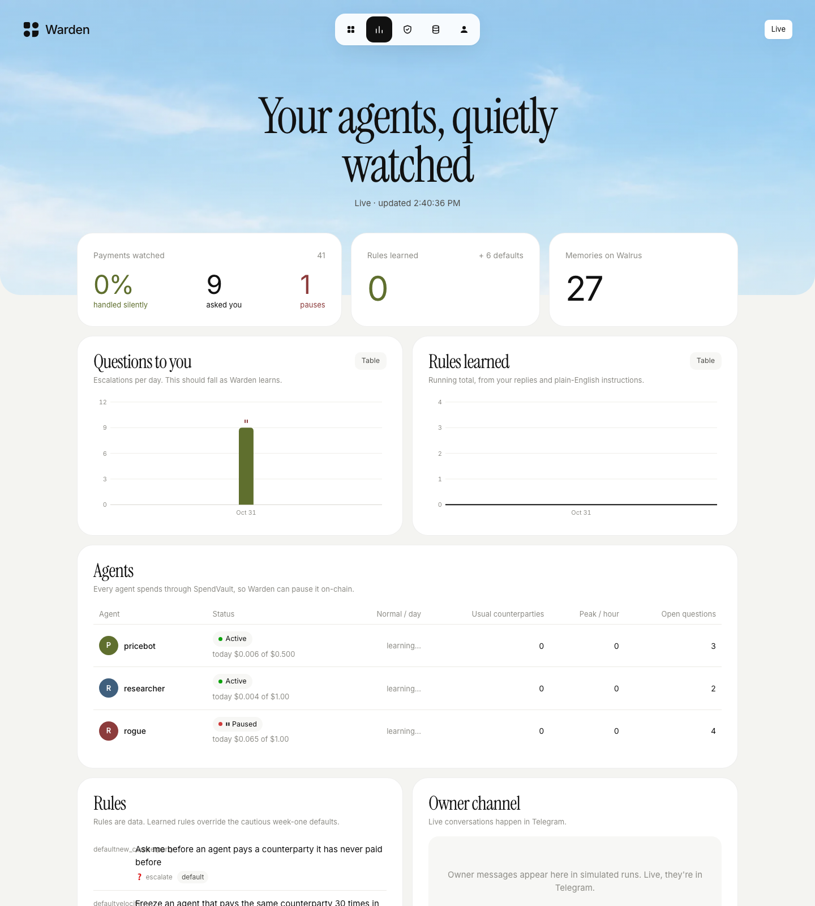
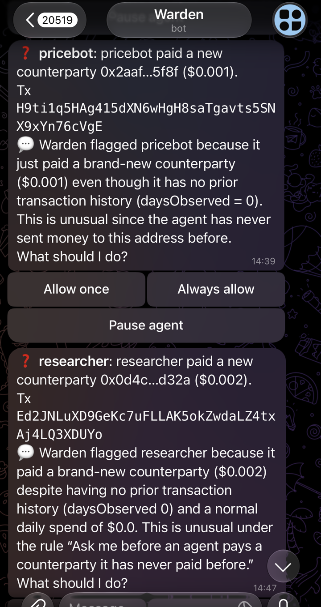
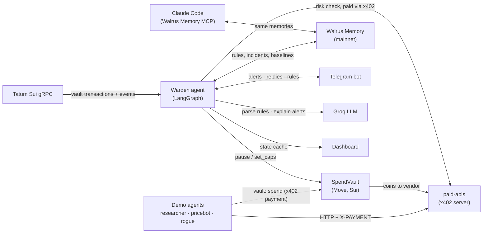
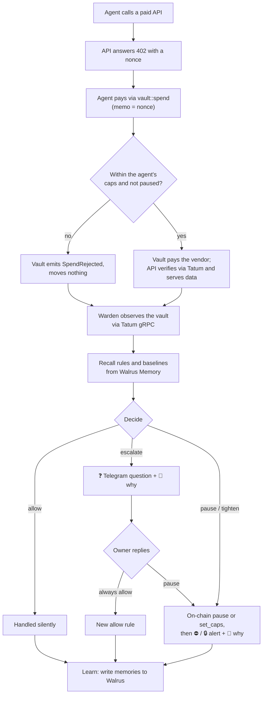

# Warden

A spend watchdog for your AI agents' wallets on Sui.

    

Warden watches every payment your AI agents make on Sui, learns what normal looks like for each agent, and enforces rules you give it once in plain English. It doesn't just alert: agents spend through a Move contract that Warden can pause on-chain, without a confirm button. Every rule, incident and owner reply lives in Walrus Memory, so Warden remembers far past the chain's 3-day window, and the same memory is readable from Claude Code.

## Demo

> 🎥 Demo video (1:44): [youtu.be/2kqzJp-XJmU](https://youtu.be/2kqzJp-XJmU)
>
> 🌐 Live: [usewarden.fly.dev](https://usewarden.fly.dev) (landing page) · [usewarden.fly.dev/try](https://usewarden.fly.dev/try) (try it with your own wallet) · [usewarden.fly.dev/dashboard](https://usewarden.fly.dev/dashboard) (live dashboard)
>
> 🤖 Telegram bot: [@usewarden_bot](https://t.me/usewarden_bot) (answers only the owner's chat during the testnet run)

[](https://youtu.be/2kqzJp-XJmU)



The screenshot is the live dashboard during a real testnet run. Warden has watched 41 payments, asked the owner 9 questions, paused the looping `rogue` agent on-chain, and written 27 memories to Walrus Memory mainnet.

### Telegram

<p>
  
  
</p>

Real alerts from the testnet run. Each question names the agent, the counterparty, the amount and the transaction. The 💬 line is the model's plain-language explanation, written after Warden has already decided. The buttons are **Allow once**, **Always allow** (which becomes a rule) and **Pause agent**.

## Contents

- [Problem](#problem)
- [Solution](#solution)
- [How to test](#how-to-test)
- [Architecture](#architecture)
- [Flowchart](#flowchart)
- [Tech stack](#tech-stack)
- [Getting started](#getting-started)
- [Project structure](#project-structure)
- [Deployment](#deployment)
- [Usage](#usage)
- [Roadmap](#roadmap)
- [Contributing](#contributing)
- [License](#license)
- [Team and acknowledgements](#team-and-acknowledgements)

## Problem

AI agents now pay for APIs, data and services on their own through x402. Most of them pay from a hot key with no spending controls:

- **No limits.** A funded agent can pay anyone, any amount, any number of times. There's no daily cap and no pause button.
- **Loops burn money quietly.** One retry bug can pay the same API dozens of times in minutes. In our testnet run, the `rogue` agent paid the same search API 30 times in 10 minutes before Warden stopped it.
- **Alerts can't stop a payment.** Monitoring tells you after the money has moved. The Sui RPC gateway also keeps only about 3 days of history, so the evidence disappears too.

## Solution

Agents spend only through **SpendVault**, a Move contract. Warden holds a `WardenCap` on it, so Warden can pause an agent or tighten its caps on-chain the moment something looks wrong. You set the rules once in plain English over Telegram. When Warden isn't sure, it asks you, and your answer becomes a new rule, so it asks less over time.

### Key features

- **Watches every payment through one call.** Every agent spends through one vault, so a single Tatum Sui gRPC query per cycle covers all of them.
- **Acts on-chain, not just alerts.** It pauses a looping agent or lowers its caps through SpendVault. The vault then refuses the agent's payments until you unpause it.
- **Rules in plain English.** "Block anything over $20/day" becomes an on-chain daily cap. A Groq-hosted model parses the wording; a pattern parser covers the demo phrasings without a key.
- **Learns from your replies.** "Always allow" on a question becomes an allow rule. After 3 approvals of new vendors for one agent, Warden generalises to an amount-bounded rule and tells you.
- **Explains its alerts.** Each Telegram alert carries a short plain-language "why", written by the model from facts Warden already computed. The model never makes or delays a decision.
- **Remembers everything in Walrus Memory.** Rules, incidents, replies, counterparties and daily baselines are written to Walrus as they happen, and are readable from Claude Code.
- **Pays for its own due diligence.** For an unknown counterparty, Warden buys a risk check over x402 from its own small wallet.

## How to test

### Try it in the browser (a Sui wallet, about 2 minutes)

Open [usewarden.fly.dev/try](https://usewarden.fly.dev/try):

1. **Connect a wallet.** Any Sui wallet works (Slush works with a Google account). You sign a one-time message. It costs nothing and moves no funds.
2. **Name your agent** and pick a demo agent to watch (`pricebot`, `researcher` or `rogue`).
3. **Set a rule in plain English**, e.g. "ask me before any new counterparty over $0.01". Warden's real parser turns it into a rule record.
4. **See what Warden would do.** Your rules plus the week-one defaults run on that agent's latest real testnet payments, each linked to Suiscan.
5. **Connect Telegram.** The bot messages you when a real payment trips your rules. Tap "Always allow" to teach it, or type new rules in the chat.

Visitors run in **shadow mode**. Their rules use the same `decide()` engine on the same payments, but only the vault owner's chat can pause the real agents. Visitor rules are saved to Walrus Memory in their own namespace (`warden-visitors`) and restored on a fresh machine.

### Fastest: the simulation (no keys, about 1 minute)

This runs Warden's real engine for 14 simulated days. Only the chain, Walrus Memory (`MemWalMock`) and Telegram are stand-ins.

```bash
pnpm install
pnpm dashboard:sim
```

Open http://localhost:4300 for the landing page, and http://localhost:4300/dashboard for the dashboard.

### Try this (simulation)

1. **Open the dashboard.** You see 14 days of payments, with questions to you falling from a few a day to zero.
2. **Look at "Rules learned".** The count climbs as the simulated owner answers questions.
3. **Find the `rogue` incident.** It's a pause, with the reason "paid … 30× in 10 min".
4. **Scroll to "Memories".** These are the plain-English records Warden keeps in Walrus Memory.

### Live on testnet

Requires the keys in [Environment variables](#environment-variables) and a deployed vault ([Deployment](#deployment)). Run each in its own terminal:

```bash
pnpm paid-apis                            # x402 services on :4021
pnpm warden                               # the watchdog
pnpm agents                               # researcher + pricebot + rogue, behaving
pnpm dashboard                            # live dashboard on :4300
```

1. **Watch the agents' terminal.** Lines like `[pricebot] paid http://localhost:4021/price/SUI (tx …)` are real x402 payments settled through the vault.
2. **Watch Telegram.** You get ❓ questions about new counterparties, each with a 💬 explanation. Tap **Always allow** on one.
3. **Make the rogue agent loop:** `pnpm --filter @warden/agents rogue`. Within one cycle after its 30th payment, Telegram shows ⛔ *Paused rogue* with the vault transaction, and the agent logs `vault blocked payment`.
4. **Type a rule in Telegram:** *block anything over $1/day*. Warden replies with the rule and the on-chain `set_caps` transaction.
5. **Send `/unpause rogue`** to resume it.

### Automated tests

```bash
pnpm test        # 52 TypeScript tests (vitest)
pnpm test:move   # 7 Move tests for SpendVault
pnpm typecheck && pnpm lint
```

Passing looks like `Tests 6 passed (6)` for `@warden/shared`, `Tests 46 passed (46)` for `@warden/warden`, and `Test result: OK. Total tests: 7; passed: 7` for Move.

## Architecture



- **SpendVault** ([vault.move](packages/vault/sources/vault.move)) holds each agent's allowance. `OwnerCap` adds agents, sets ceilings, withdraws and rotates the warden. `WardenCap` can pause, unpause and `set_caps`, only at or below the owner's ceilings. Each agent gets one `SpenderCap`. A spend that breaks a limit doesn't abort: it emits `SpendRejected` and moves nothing, so Warden sees a paused agent still trying.
- **Warden** ([packages/warden](packages/warden)) runs one LangGraph cycle per poll: Observe → Recall → Assess → Decide → Act → Learn. Every payment decision is deterministic code.
- **Tatum Sui gRPC** is the live chain feed. Sui deprecated JSON-RPC in 2026, and Tatum's gateway blocks `ListEvents`, so Warden lists transactions that touched the vault object. Every vault function takes `&mut Vault`, so nothing is missed. Events are decoded from BCS.
- **Walrus Memory** is the long-term record. The gateway keeps about 3 days of history; Walrus keeps everything. Writes are queued, retried and persisted locally, so a relayer outage never drops a memory.
- **paid-apis** serves x402 (`402` + `accepts[]`, then `X-PAYMENT` / `X-PAYMENT-RESPONSE`), settled on Sui. It verifies each payment through Tatum and redeems each transaction digest once.
- **Groq LLM** does two things only: it turns your messages into rules, and it writes the 💬 explanation under alerts. Its output is schema-checked, and the explanation is requested after Warden has already acted.

## Flowchart



## Tech stack

| Area | Tools |
|---|---|
| Smart contract | Move on Sui (`spend_vault` package) |
| Agent | TypeScript, LangGraph JS (`@langchain/langgraph`), zod |
| Chain access | `@mysten/sui` 2.x gRPC client over Tatum's Sui gRPC gateway, `@grpc/grpc-js` |
| Memory | Walrus Memory (`@mysten-incubation/memwal`), mainnet |
| Payments | x402, self-hosted and settled on Sui |
| LLM | Groq (`openai/gpt-oss-120b` by default), called over its OpenAI-compatible API |
| Owner channel | Telegram Bot API (no SDK) |
| Dashboard | Node `http` server, plain HTML/CSS/JS |
| Tooling | pnpm workspaces, tsx, vitest, ESLint, Sui CLI |

## Getting started

### Prerequisites

- Node.js 20 or newer, and pnpm 10
- Sui CLI (to publish SpendVault)
- A Tatum API key, a Walrus Memory account with a delegate key, a Telegram bot token from @BotFather, and (optional) a Groq API key

### Installation

```bash
git clone _add repo URL_ warden
cd warden
pnpm install
cp .env.example .env
```

### Environment variables

| Variable | Purpose | Required |
|---|---|---|
| `TATUM_API_KEY` | Tatum API key, sent as `x-api-key` | Yes (live) |
| `TATUM_SUI_RPC_URL` | Tatum Sui gRPC endpoint, e.g. `https://sui-testnet-grpc.gateway.tatum.io` | Yes (live) |
| `TATUM_MAX_RPS` | Per-process call rate cap. Default `3` | No |
| `TATUM_ACCOUNT_ID` | For the hackathon submission form only | No |
| `MEMWAL_DELEGATE_KEY` | Walrus Memory delegate private key | Yes (live) |
| `MEMWAL_ACCOUNT_ID` | Walrus Memory account object ID | Yes (live) |
| `MEMWAL_AGENT_ID` | Delegate public key (submission form) | No |
| `MEMWAL_SERVER_URL` | Relayer URL. Default `https://relayer.memory.walrus.xyz` | No |
| `MEMWAL_NAMESPACE` | Memory namespace. Default `warden` | No |
| `MEMWAL_MODE` | `live`, or `mock` to run fully offline | No |
| `SUI_NETWORK` | `testnet` or `mainnet` | Yes |
| `VAULT_PACKAGE_ID`, `VAULT_OBJECT_ID`, `VAULT_COIN_TYPE` | The deployed SpendVault (printed by `setup`) | Yes (live) |
| `VAULT_COIN_USD`, `VAULT_COIN_DECIMALS` | Display price and decimals, since rules are written in dollars | No |
| `WARDEN_PRIVATE_KEY`, `WARDEN_CAP_ID` | Warden's key and its `WardenCap` (printed by `setup`) | Yes (to act on-chain) |
| `OWNER_ADDRESS` | Vault owner address (printed by `setup`) | No |
| `RESEARCHER_*`, `PRICEBOT_*`, `ROGUE_*` (`_PRIVATE_KEY`, `_CAP_ID`) | Demo agent keys and `SpenderCap`s (printed by `setup`) | For the demo agents |
| `PAID_API_URL` | Where the x402 services run. Default `http://localhost:4021` | Yes (live) |
| `PAID_API_PAYTO` | Address that receives x402 payments | Yes (paid-apis) |
| `PAID_API_VENDORS` | `name:address,…` so vendors look like different counterparties | No |
| `X402_PAYER_KEY` | Warden's small wallet for paid risk checks | No (risk checks off without it) |
| `GROQ_API_KEY` | Enables the Groq rule parser and alert explanations | No |
| `GROQ_MODEL` | Default `openai/gpt-oss-120b` | No |
| `TELEGRAM_BOT_TOKEN`, `TELEGRAM_OWNER_CHAT_ID` | Owner channel. Without them, messages print to the console | No |
| `POLL_FAST_MS`, `POLL_IDLE_MS` | Poll every 15 s after activity, backing off to 120 s when idle | No |
| `WARDEN_API_PORT`, `PUBLIC_URL` | Private "Try Warden" API on localhost (default `4310`, proxied by the dashboard at `/api/try/*`) and the site URL used in bot messages | No |
| `WARDEN_STATE_DIR`, `DASHBOARD_PORT` | Local state cache (default `../../.warden`) and dashboard port (default `4300`) | No |

Never commit `.env`. It is in `.gitignore`.

### Run locally

```bash
pnpm dashboard:sim   # simulation, no keys: http://localhost:4300
```

For the live system, see [Live on testnet](#live-on-testnet) and [Deployment](#deployment).

## Project structure

```text
packages/
  vault/       Move: SpendVault + 7 unit tests
  shared/      Tatum gRPC client and rate limiter, vault events (BCS) and tx builders, x402 client + gate
  warden/      the agent: memory/ (Walrus), policy/ (rules, parser, alert explainer), act/, graph.ts (LangGraph), main.ts
  bot/         Telegram owner channel (raw Bot API) + console fallback
  agents/      researcher / pricebot / rogue, one-time vault setup, coin-from-balance helper
  paid-apis/   x402 demo services: search, price feed, counterparty risk check
  dashboard/   landing page + dashboard over Warden's state (live or a 14-day simulation)
docs/          demo script and screenshots
```

## Deployment

### Current testnet deployment

| Item | Value |
|---|---|
| SpendVault package | [`0x36b2d648…efafaf`](https://suiscan.xyz/testnet/object/0x36b2d648497cecdf9502f5177ea2f3f7942dceb552a174f77421f65982efafaf) |
| Vault object | [`0x3b7388b0…113135`](https://suiscan.xyz/testnet/object/0x3b7388b0d82848c22a3bdf58fff56c96639d49a8e8278796473a638650113135) |
| Publish tx | [`FrUyqASe…BC5P`](https://suiscan.xyz/testnet/tx/FrUyqASeLSFvemXRT7R3ShKK1auMdGrSe3f2U2jxBC5P) |
| Setup txs | [`4YCvAL6h…2ynCm`](https://suiscan.xyz/testnet/tx/4YCvAL6hx3CnFrZ1h9LKKhNA2Xg4wvnruKwoGcX2ynCm), [`8smXVajN…L3yW`](https://suiscan.xyz/testnet/tx/8smXVajNmS3B5A876XTayaDuZwystarVN4jAwmjxL3yW) |
| `WardenCap` (held by Warden) | [`0x2deafd19…398d18`](https://suiscan.xyz/testnet/object/0x2deafd19121cb4e4294b490c1f2de14c35dea7b33b94187bfad026f51d398d18) |
| `SpenderCap`: researcher | [`0x10967231…ed9478`](https://suiscan.xyz/testnet/object/0x10967231d824cc6eb76343ce328a86dbdc03aa2033e59c185cd15e73c6ed9478) |
| `SpenderCap`: pricebot | [`0xb26fcb7f…6ff37e`](https://suiscan.xyz/testnet/object/0xb26fcb7fe7d1525050a54d8fd7141fb842b4f1f56c7873d73d3eea11536ff37e) |
| `SpenderCap`: rogue | [`0x0a91b7a6…75c630`](https://suiscan.xyz/testnet/object/0x0a91b7a6048bad89c1b87c6887c10697551bf2632f2e89b9136812e5a575c630) |
| Vault owner | [`0x1f218133…23e6f4`](https://suiscan.xyz/testnet/account/0x1f218133c180002e9ba3d14fc29e13bdcedfd33e463fef77e0b3ec357823e6f4) |
| Example agent payment (x402 via vault) | [`3N1pdRKp…xt4d`](https://suiscan.xyz/testnet/tx/3N1pdRKpJL7M5Zn46sDsXaBucrc81Fj4yDZCdGftxt4d) |
| Example risk check Warden paid for (x402) | [`88zNpyJA…zdAR`](https://suiscan.xyz/testnet/tx/88zNpyJAkCfGhQz6UgET8nnxMJb988Dh8qwGbvZPzdAR) |
| Warden pausing `rogue` on-chain (30 payments in 10 min) | [`FimJPaM3…pju8`](https://suiscan.xyz/testnet/tx/FimJPaM3fQ5kw6NA29VmGSAg23xkar1NjGc71X9Ypju8) |

Walrus Memory writes go to mainnet through the relayer (30 written so far in the testnet run).

### Deploy your own

```bash
sui client switch --env testnet
# The testnet faucet now credits an address balance, not coin objects, and older CLIs
# can't pay gas from it. If `sui client gas` is empty, move some into a coin first:
OWNER_PRIVATE_KEY=$(sui keytool export --key-identity <owner> --json | jq -r .exportedPrivateKey) \
  pnpm --filter @warden/agents coin-from-balance -- --sui 0.5

cd packages/vault && sui client publish        # note the PackageID → VAULT_PACKAGE_ID
cd ../..
OWNER_PRIVATE_KEY=$(sui keytool export --key-identity <owner> --json | jq -r .exportedPrivateKey) \
  VAULT_PACKAGE_ID=0x… pnpm --filter @warden/agents run setup -- --deposit-usd 0.25
```

`setup` creates the vault, appoints Warden, registers the 3 agents with caps, funds their gas and the vault, then prints the `.env` lines. Use `run setup`: plain `pnpm … setup` collides with pnpm's built-in command.

Gas note: each agent payment costs about 0.003 SUI in gas. Fund agents accordingly for multi-day runs.

### Host it on Fly.io

The whole stack runs as one always-on machine. [scripts/start-all.mjs](scripts/start-all.mjs) supervises the paid APIs, Warden, the agents and the dashboard, restarting any that crash. The dashboard is served on Fly's public URL. No volume is needed: on boot, Warden rebuilds its memory from Walrus.

```bash
brew install flyctl && fly auth login
# set `app` in fly.toml to a unique name, then:
fly apps create <app-name>
grep -E '^[A-Z_0-9]+=[^ #]' .env | sed -E 's/[[:space:]]+#.*$//' | fly secrets import   # secrets from .env, never baked into the image
fly deploy --ha=false   # exactly one machine: two Wardens would act twice and fight over the Telegram bot
```

Run only one copy at a time. Stop any local run before deploying, because Telegram allows one poller per bot token.

Run it locally the same way with `pnpm start` (`PORT` sets the dashboard port; `RUN_AGENTS=false` skips the demo agents).

## Usage

### Telegram

| Command | What it does |
|---|---|
| `/status` | Each agent's state and today's spend, memory stats, Tatum credits used |
| `/rules` | All rules and where they came from |
| `/digest` | Today's summary |
| `/undo rule_007` | Disable a rule |
| `/unpause rogue` | Resume a paused agent |
| any plain-English rule | e.g. *ask me before any new counterparty over $5* |

Alert buttons: **Allow once**, **Always allow** (becomes a rule) and **Pause agent** on questions; **Keep paused**, **Unpause** and **Unpause + always allow** on pauses.

### What a memory looks like

Each memory is a plain-English sentence followed by a JSON tail:

```text
Warden rule rule_004 (active, from feedback): "researcher may pay new counterparties up to $0.003 without asking (generalised from 3 approvals)" → allow (only for agent researcher).
---warden type=rule key=rule_004 rev=1 at=2026-10-29T10:14:03.120Z---
{"type":"rule","id":"rule_004",...}
```

The sentence makes semantic recall and Claude Code useful. The tail lets Warden rebuild its exact state on a fresh machine (`rebuildFromWalrus`; the newest revision wins). Each write carries an idempotency key.

### Claude Code portability

Add the Walrus Memory MCP server (`@mysten-incubation/memwal-mcp`) to Claude Code, signed in to the same account, and ask *"what rules has Warden learned?"* or *"why was rogue paused?"*. Recall returns the same memories, including the alert explanation. A rule written from Claude Code in the format above, with a higher `rev`, is picked up by Warden within 10 minutes.

### Scripts

```bash
pnpm --filter @warden/warden spike:tatum     # checks every Tatum gRPC call Warden uses (read-only)
pnpm --filter @warden/warden spike:memory    # one real Walrus Memory write + recall
pnpm --filter @warden/warden metrics > docs/learning-curve.csv   # per-day learning curve
```

## Roadmap

- [x] SpendVault Move contract with caps, pause and owner ceilings (7 tests)
- [x] Warden loop on LangGraph: observe, recall, assess, decide, act, learn
- [x] Chain layer on Tatum Sui gRPC (Sui's JSON-RPC is deprecated)
- [x] Walrus Memory writes and recall on mainnet
- [x] Real x402 payments settled on Sui testnet through the vault
- [x] On-chain pause of a looping agent, verified live
- [x] Telegram owner channel with plain-English rules (Groq) and explained alerts
- [x] Live dashboard and landing page
- [x] Host the stack 24/7 on Fly.io with a public dashboard link
- [ ] Multi-day run to show the learning curve on real data
- [ ] Public Telegram demo mode for judges
- [ ] Decide on a mainnet SpendVault deployment
- [ ] Verify Tatum credit cost per gRPC method (the meter counts 1 per call; see `CREDIT_COST` in [rpc.ts](packages/shared/src/rpc.ts))

## Contributing

1. Fork the repo and create a branch: `git checkout -b my-change`.
2. Keep the checks green: `pnpm typecheck && pnpm lint && pnpm test && pnpm test:move`.
3. Add or update tests for behaviour changes. Every actuator must stay idempotent.
4. Open a pull request describing the change and how you tested it.

Never commit keys. Secrets belong in `.env`.

## License

[MIT](LICENSE) © 2026 mrfomoweb3

## Team and acknowledgements

- Built by _add team names and links_.
- Built for **Total Recall: Tatum × Walrus Memory** (Smart Agents for Real Life, plus the Best Walrus Memory and Best Use of Agent Payments bonuses).
- Thanks to [Tatum](https://tatum.io) for the Sui gRPC gateway, [Walrus](https://walrus.xyz) for Walrus Memory, [Mysten Labs](https://mystenlabs.com) for Sui and the TypeScript SDK, [LangGraph](https://github.com/langchain-ai/langgraphjs), and [Groq](https://groq.com).
